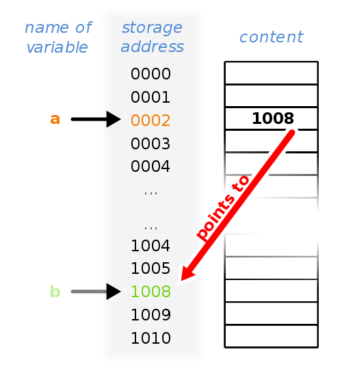

Pointers are a fundamental concept in C programming. A pointer stores the memory address of another variable, which allows direct access to data in memory. This is essential for writing efficient programs, passing data to functions, and building dynamic data structures.

#### Memory Address of Variables

Every variable is stored at some memory location.

```c
int A = 10;
```

Here, `A` has:

1. A value (`10`)
2. An address (obtained using `&A`)

In the simulation, this is shown in the **Memory Map** where variable names, addresses, and bytes are displayed together.

#### Declaring, Referencing, and Dereferencing Pointers

A pointer is declared using `*`:

```c
int *P;
```

Assign an address to the pointer using `&` (address-of operator):

```c
P = &A;
```

Now `P` stores the address of `A`. Dereferencing accesses the value at that address:

```c

printf("%d\n", *P);
*P = 20;
```

After `*P = 20`, the value of `A` also becomes `20` because `P` points to `A`.

#### Call by Value vs Call by Reference (Simulation Context)

In **Call By Value**, a function receives copies of values. Modifying copies does not change original variables in the caller.

In **Call By Reference** (using pointers), a function receives addresses of variables:

```c
swap(&A, &B);
```

Inside the function, pointer parameters dereference those addresses and modify original data. That is why values of `A` and `B` get swapped in caller memory.

This directly demonstrates pointer referencing (`&`) and dereferencing (`*`) in practical function design.

#### Pointers and Arrays

Array name behaves like a pointer to the first element.

```c
int arr[100];
```

`arr[3]` and `*(arr + 3)` refer to the same element. Pointer arithmetic advances by element size, not by one byte for all types.

#### Dynamic Memory Allocation

Pointers are required to allocate memory at runtime.

```c

#include <stdlib.h>

int n = 20;
int *ptr = (int *)malloc(n * sizeof(int));
```

`malloc` returns the starting address of allocated memory. This address is stored in the pointer.

Always check allocation and free memory after use:

```c

if (ptr == NULL) {
	// allocation failed
}

free(ptr);
ptr = NULL;
```

This is important for safe and correct C programming.

#### Why Pointers Matter

Pointers are used to:

1. Access variable addresses directly.
2. Implement call by reference behavior in functions.
3. Create dynamic arrays, linked lists, trees, and other structures.
4. Manage memory efficiently in systems-level programming.


